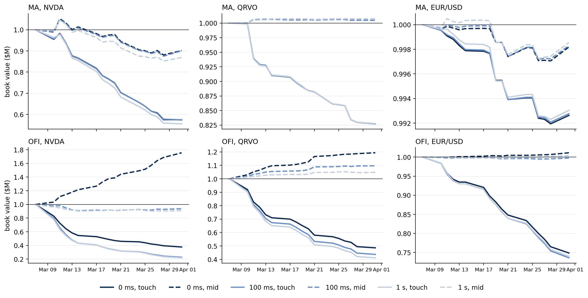
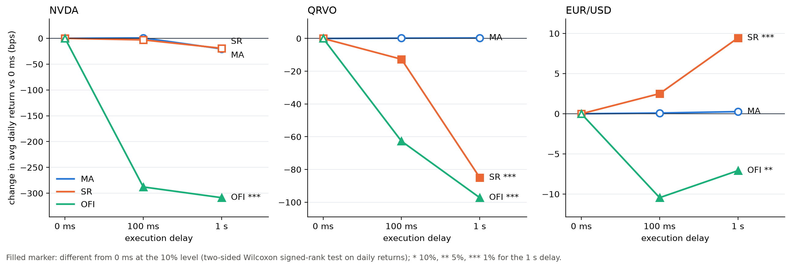
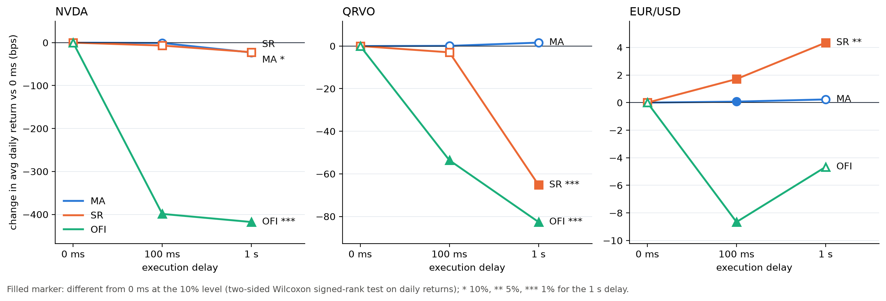
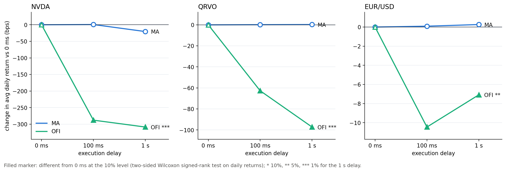
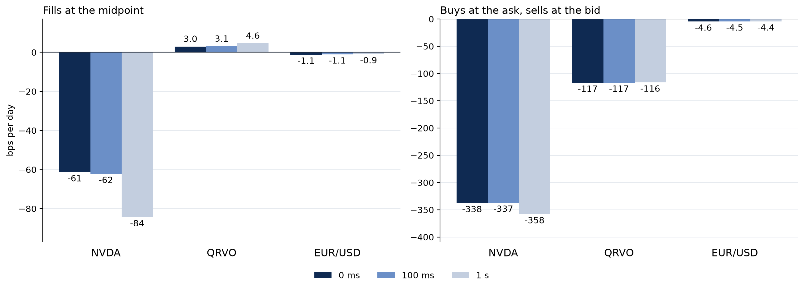
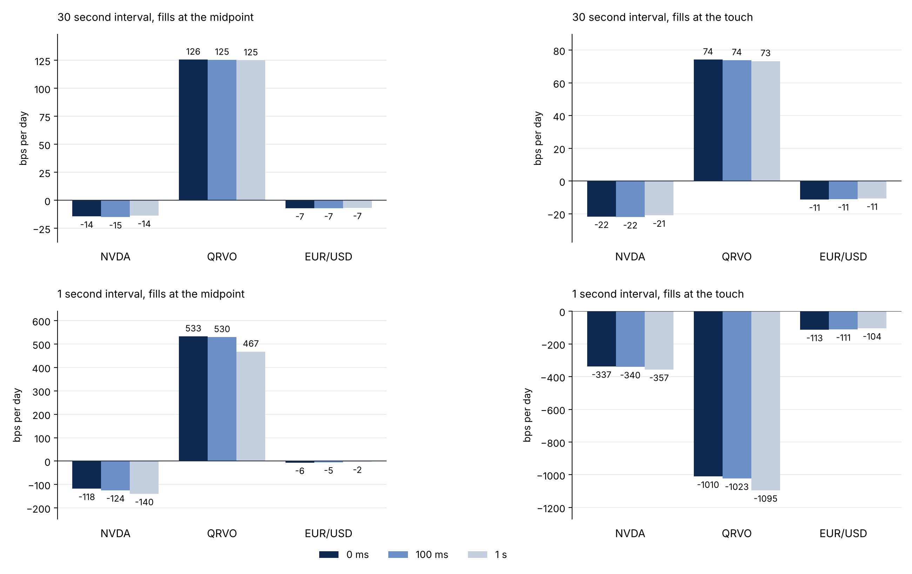
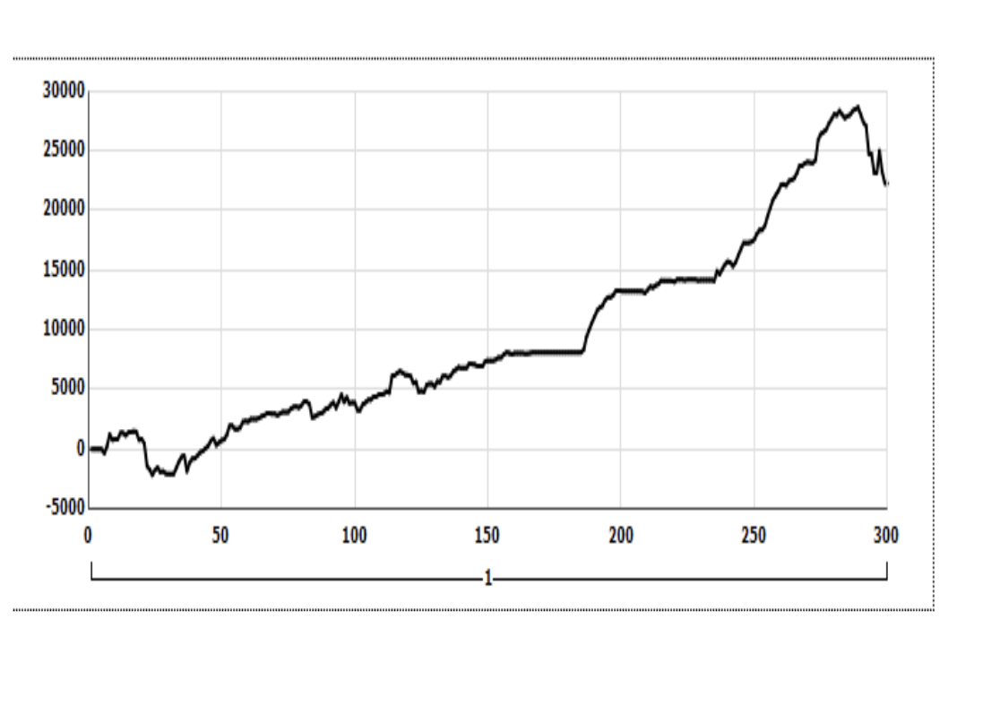

# High-Frequency Finance — UC Berkeley MFE 230X

**Market microstructure | Trading signals | Execution latency | Transaction costs**

This UC Berkeley Master of Financial Engineering project studies whether high-frequency trading signals remain economically useful after accounting for **bid–ask spreads and execution delay**. We compare liquid and less-liquid equities with EUR/USD futures, using a shared intraday backtesting framework and a March 2025 evaluation sample.

> **Main takeaway:** Midpoint backtests can dramatically overstate implementable performance. Execution at the bid/ask and delays of 100 ms to 1 second often erode returns; the impact depends on the signal and asset. These are experimental backtests, not evidence of a deployable trading system.

## Contents

- [Project objectives](#project-objectives)
- [Data and research design](#data-and-research-design)
- [Strategies](#strategies)
- [Execution and risk metrics](#execution-and-risk-metrics)
- [Repository structure](#repository-structure)
- [Empirical results](#empirical-results)
- [Figures](#figures)
- [Reproduction](#reproduction)
- [Limitations](#limitations)
- [Contributors](#contributors)

## Project objectives

The project investigates how **market microstructure and execution constraints** affect short-horizon trading rules. Specifically:

1. Compare the quote activity of **NVDA** (high liquidity), **QRVO** (relatively lower liquidity), and **EUR/USD** (CME 6E futures).
2. Develop and test **Moving Average (MA)**, **Support and Resistance (SR)**, and **Order Flow Imbalance (OFI)** rules.
3. Compare idealized midpoint fills with execution at the **best ask for buys** and **best bid for sells**.
4. Quantify the effect of **0 ms, 100 ms, and 1 second** delays on returns and trading costs.
5. Report compounded P&L, daily risk measures, and statistical comparisons of delayed versus zero-delay execution.

## Data and research design

| Item | Design |
|---|---|
| Instruments | NVDA, QRVO, EUR/USD via CME 6E futures |
| Market data | Intraday best quotes, quote sizes, and trades |
| Study month | March 2025 |
| Initial calibration | March 3–7, 2025 |
| Evaluation | March 10–31, 2025 (typically 16 trading days) |
| Delay experiments | 0 ms, 100 ms, 1 second |
| Execution conventions | Midpoint (before spread); touch (buy ask/sell bid) |
| Initial simulated book | $1,000,000 per signal–asset–scenario |
| Positions | -1, 0, +1; closed daily |
| Frequency | Primary MA and SR: 1-second; alternative SR: 30-second |

**Coverage note:** A few saved MA/EURUSD results report 14 days rather than 16; compare runs using their recorded `days` column.

### Research workflow

```text
Intraday quote/trade files
         ↓
Download, clean, and form daily quote data
         ↓
Quote activity, midpoint, spread and order flow
         ↓
MA / SR / OFI signals → target positions {-1,0,+1}
         ↓
Execution engine: 0 ms / 100 ms / 1 s
         ↓
Midpoint vs bid/ask fills + daily close-outs
         ↓
Compounded portfolio value and round-trip trades
         ↓
P&L, Sharpe, drawdown, delay costs and figures
```

## Strategies

### Moving Average (MA)

A trend-following rule compares short- and long-horizon moving averages of the quote midpoint, with a threshold band. The notebook uses a **1-second observation grid** to examine short execution delays.

### Support and Resistance (SR)

A strategy driven by levels derived from historical prices. The experiment includes a **1-second** configuration (`SR`) and a **30-second** alternative (`SR-30s`). These can have sharply different turnover and must be treated as distinct specifications.

### Order Flow Imbalance (OFI)

A short-horizon rule constructed from quote and displayed-size changes at the best bid and offer. Calibration-period thresholds are used to convert the flow signal to trading positions. OFI is particularly exposed to transaction costs due to frequent position changes.

### Additional proposed idea

The notebook introduces **z-score mean reversion** as a potential complementary signal. The committed comparison datasets primarily validate **MA, SR and OFI**, so z-score mean reversion is not presented here as a completed result.

## Execution and risk metrics

The shared notebook backtester translates signal changes into target positions and executes them against the prevailing quotes at `signal time + delay`.

- **Touch:** buy at ask, sell at bid (quoted spread-crossing costs).
- **Mid:** both sides execute at midprice, an idealized diagnostic rather than a guaranteed executable price.
- **Compounding:** starting $1 million book is reallocated on each entry and daily book values carry forward.
- **Daily liquidation:** positions are closed at the day's final quote; no overnight inventory.
- **EUR/USD:** implementation uses the CME 6E multiplier of **125,000 EUR**; fractional contract sizing is an analytical convenience.

Reports include **total return, final value, round trips, hit rate, mean holding time, mean daily return, annualized Sharpe, maximum drawdown, and worst daily return**. Delay comparisons calculate paired daily-return differences against 0 ms and report **two-sided Wilcoxon signed-rank tests**.

## Repository structure

The earlier coursework material remains at repository root. The newer, consolidated final deliverable is in `Final_Project/`.

```text
High-Frequency-Finance-MFE/
├── README.md                           # Overview, methodology and results
├── Assignment/                         # Earlier notebook, CSV results, figures
├── Rit_algo_2/                          # Earlier RIT algorithm scripts
├── rit_algo2e.py                        # RIT algorithm script
└── Final_Project/
    ├── README.md                        # Original short README
    ├── Final_assignment.pdf             # Final report (copy)
    ├── rit_algo2e.py                    # RIT algorithm script
    ├── Rit_algo_2/                      # Individual team RIT scripts
    └── Assignment/
        ├── Final_assignment.ipynb       # Complete notebook
        ├── Final_assignment.pdf         # Formatted report
        ├── Final_assignment.tex         # LaTeX report source
        ├── MFE230X_project_2026.pdf     # Assignment brief
        ├── backtest_results.csv         # Results by signal/asset/delay/fill
        ├── daily_values.csv             # Daily book value
        ├── pnl_reports.csv              # Return and risk metrics
        ├── cost_of_delay.csv            # Paired delay comparisons
        ├── sr_results.csv               # SR at 1 s / 30 s intervals
        ├── sr_daily_results.csv         # SR daily results
        ├── ofi_delay_results.csv        # Daily OFI delay results
        ├── tick_frequency.csv           # Intraday market activity
        ├── pnl_equity_curves.png        # Strategy P&L time series
        ├── cost_of_delay_touch.png      # Execution delay (touch)
        ├── cost_of_delay_mid.png        # Execution delay (mid)
        ├── fig6_cost_of_delay.png       # Delay-comparison figure
        ├── fig6_cost_of_delay_mid.png   # Midpoint counterpart
        ├── ma_delay.png                 # MA delay figure
        ├── sr_delay.png                 # SR delay figure
        ├── algo2e_pnl.png               # RIT simulation P&L graphic
        └── ...                          # Other diagnostics and figures
```

The full cleaned high-frequency quote/trade files are **not included** in GitHub; reproducing the full pipeline requires access to the corresponding data and any necessary vendor credentials.

## Empirical results

### Selected baseline results — 0 ms, *touch* fills

All returns are **total compounded returns**, not annualized, from the documented $1 million book.

| Signal | Asset | Total return | Test days |
|---|---|---:|---:|
| MA | NVDA | **−42.57%** | 16 |
| MA | QRVO | **−17.28%** | 16 |
| MA | EUR/USD | **−0.74%** | 14 |
| OFI | NVDA | **−62.27%** | 16 |
| OFI | QRVO | **−51.39%** | 16 |
| OFI | EUR/USD | **−25.16%** | 16 |
| SR (1 s) | NVDA | **−42.89%** | 16 |
| SR (1 s) | QRVO | **−81.93%** | 16 |
| SR (30 s) | QRVO | **+12.35%** | 16 |

Sources: [`pnl_reports.csv`](Final_Project/Assignment/pnl_reports.csv) and [`sr_results.csv`](Final_Project/Assignment/sr_results.csv). **SR-30s is a different frequency specification.** Do not interpret it as the same strategy with one minor execution adjustment.

### Midpoint backtests can overstate realizable profitability

- **OFI / NVDA, 0 ms:** **+75.46% at mid** versus **−62.27% at touch**.
- **SR (1 s) / QRVO, 0 ms:** **+128.04% at mid** versus **−81.93% at touch**.

These large divergences reinforce that very high turnover and repeated spread crossing can overwhelm an apparent midpoint signal.

### Delays materially affect some strategies

| OFI strategy | 0 ms touch | 100 ms touch | 1 s touch |
|---|---:|---:|---:|
| NVDA | −62.27% | −77.23% | −78.08% |
| QRVO | −51.39% | −56.30% | −58.83% |

For OFI/NVDA and OFI/QRVO, the paired daily-return delay comparisons in [`cost_of_delay.csv`](Final_Project/Assignment/cost_of_delay.csv) report **Wilcoxon p ≈ 0.0000305** at both 100 ms and 1 s under touch fills. **Not every comparison deteriorates**: some SR/EURUSD delayed results improve, so the conclusion is that latency effects are **asset- and signal-dependent**.

For the full matrix (including risk, turnover and the before-spread diagnostic) inspect [`pnl_reports.csv`](Final_Project/Assignment/pnl_reports.csv), [`cost_of_delay.csv`](Final_Project/Assignment/cost_of_delay.csv), and the [final report](Final_Project/Assignment/Final_assignment.pdf).

## Figures

All images below link to files already present in the GitHub repository.

### Equity curves / portfolio values



### Execution delay — realistic touch fills



### Execution delay — before spread



### Cost-of-delay comparison (Figure 6-style)



### Moving Average and Support & Resistance





### RIT algorithm backtest graphic



Additional figures: [delay before spread](Final_Project/Assignment/delay_before_spread.png), [delay after spread](Final_Project/Assignment/delay_after_spread.png), [midpoint Figure 6](Final_Project/Assignment/fig6_cost_of_delay_mid.png).

## Reproduction

### Inspect saved results

The repository includes the final [PDF report](Final_Project/Assignment/Final_assignment.pdf), [Jupyter notebook](Final_Project/Assignment/Final_assignment.ipynb), saved output tables, and graphics. These can be inspected **without acquiring the underlying licensed high-frequency data**.

### Run the notebook

```bash
# From your local GitHub checkout
git clone https://github.com/rezazamani2329/High-Frequency-Finance-MFE.git
cd High-Frequency-Finance-MFE/Final_Project/Assignment
python3 -m venv .venv
source .venv/bin/activate
python -m pip install --upgrade pip
python -m pip install jupyterlab numpy pandas scipy matplotlib pyarrow
jupyter lab Final_assignment.ipynb
```

The packages above are a **starting point**, not a fully pinned environment. Some data-download sections may need additional dependencies, credentials, and authorized vendor access.

The notebook explains how to download and clean quotes and trades into `data/clean/`. If cleaned files are already present, use its **“Start here if you already have the clean data”** section. To manage memory, quote processing operates one trading day at a time; this is important for NVDA's very large intraday dataset. Shared result helpers allow running signal blocks separately while collecting consolidated reports.

## Limitations

- **Time span:** One month with approximately 16 test days cannot establish broad out-of-sample robustness.
- **Execution:** Quote-based simulation does not reproduce order-queue priority, stochastic fills, full market impact or venue-specific fees.
- **Turnover:** Repeated full-book entries can exaggerate spread costs relative to capacity-aware execution.
- **Sizing:** Fractional futures quantities and full-book reinvestment are simplifying assumptions.
- **Heterogeneous coverage:** Use each result row's stated number of days.
- **Interpretation:** This is an academic market microstructure and execution study, **not** an investment recommendation or live trading track record.

## Contributors

UC Berkeley MFE 230X final-assignment team:

- Daisy Niu
- Hrafnhildur Jonsdottir
- Paraj Goyal
- **Reza Zamani**
- Saurabh Baranwal

The notebook refers to **Scholtus and van Dijk (2012)** for the moving-average specification and to the course-assigned research paper for the cost-of-delay comparison. Please consult the included [course assignment](Final_Project/Assignment/MFE230X_project_2026.pdf), [report](Final_Project/Assignment/Final_assignment.pdf) and notebook for detailed attribution and implementation choices.

**Repository:** [rezazamani2329/High-Frequency-Finance-MFE](https://github.com/rezazamani2329/High-Frequency-Finance-MFE)  
**Maintainer:** [Reza Zamani](https://github.com/rezazamani2329)

*For academic and educational purposes only.*
